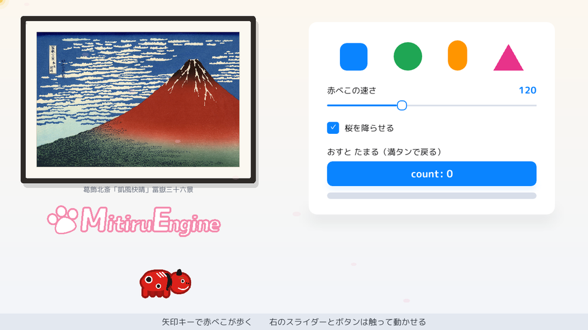

# MitiruEngine

C++ のゲームエンジンです。ゲームのルールは C++ で、画面は RML / RCSS (HTML / CSS に近い書き方) で書きます。Windows 10 / 11 (x64) 用です。



## 使う

先に `mitiru` を入れます。PowerShell かコマンドプロンプトで次の 2 行を実行してください。MSVC Build Tools が無い PC では `winget` で入れるので、5〜15 分かかります。

```bash
curl.exe -L -o mitiru.exe https://github.com/mogmog-0110/mitiru-cli/releases/latest/download/mitiru_windows_amd64.exe
.\mitiru.exe install
```

新しいターミナルを開いて、ゲームを作って動かします。

```bash
mitiru new my-game
cd my-game
mitiru run
```

`mitiru run` の代わりに `mitiru watch` で起動すると、`src/` を保存するたびに、状態を保ったまま反映されます。

## ゲームの最小形

```cpp
#include <mitiru.hpp>
using namespace mitiru;

struct MyGame {
    float x = 640, y = 360;

    void update(Input in, float dt) {
        x += in.move().x * 600 * dt;
    }
    void draw(Screen& s) {
        s.fillCircle(x, y, 24, color::Cyan);
    }
};
MITIRU_GAME(MyGame)
```

状態は 1 つの `struct` に置きます。ポインタを持たず、まるごとコピーできる形にすると、巻き戻し、録画、再生、セーブが同じ仕組みで使えます。

## ライセンス

ゲーム制作には自由に使えます (商用も可)。エンジン本体の改変と再配布はできません。詳しくは `LICENSE` を、同梱している第三者のソフトウェアとフォントは `THIRD_PARTY_NOTICES.txt` を見てください。
